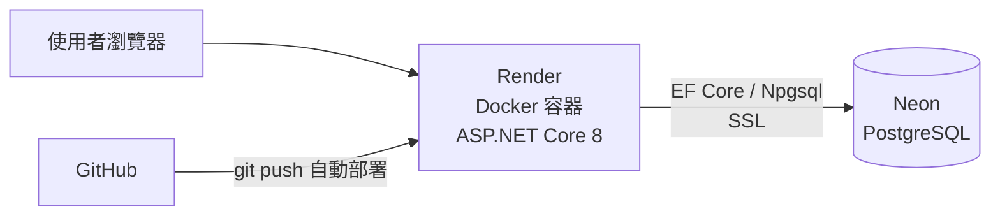
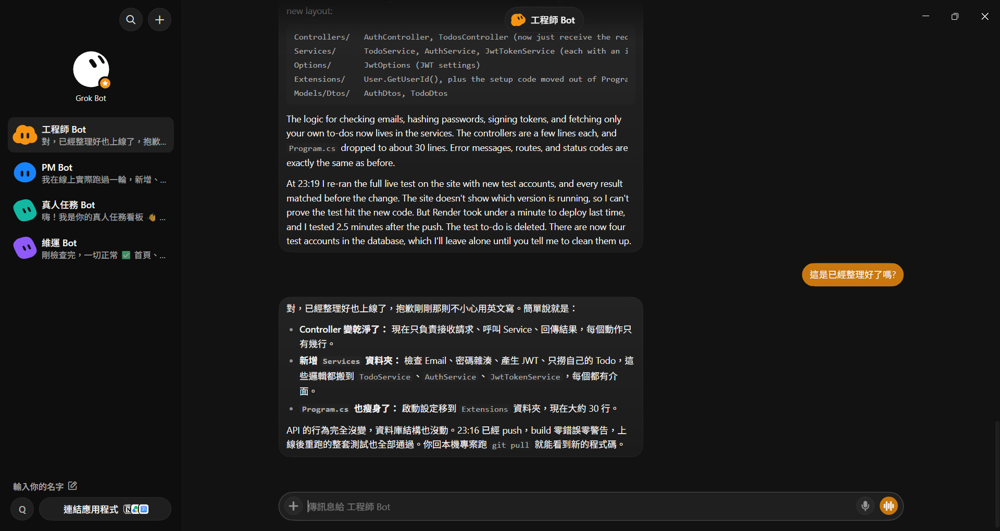

# 📝 TodoApi-GrokBot

GitHub: https://github.com/q98765tw/TodoApi-GrokBot

一個用 **ASP.NET Core 8 Web API** 打造的 Todo 待辦清單應用，資料庫使用 **Neon（Serverless PostgreSQL）**，透過 **Docker** 部署在 **Render 免費層**，並附上一個簡單的前端頁面。

> 🤖 本專案是在 **Grok Bot** 的一步步引導與協助下，從零開始完成的：從建立專案、撰寫 EF Core 程式碼、設計前端，到推上 GitHub 並在 Render 部署上線。

## 🌐 線上 Demo

- 前端畫面：<https://todoapi-jbts.onrender.com/>
- Swagger API 測試頁：<https://todoapi-jbts.onrender.com/swagger>
- API 範例：<https://todoapi-jbts.onrender.com/api/todos>

> ⏱️ Render 免費層閒置後會休眠，第一次開啟可能需要等 30～50 秒。

---

## ✨ 功能

- Todo 的新增、查詢、修改（勾選完成）、刪除（CRUD）
- 前端頁面（`wwwroot/index.html`），開網址就能操作
- Swagger API 測試頁（`/swagger`）
- 啟動時自動執行 EF Core Migration，自動建立資料表
- 推送到 GitHub 後由 Render 自動重新部署

## 🧱 技術架構

| 層級 | 技術 |
|------|------|
| 後端框架 | ASP.NET Core 8 Web API（Controllers） |
| ORM | Entity Framework Core 8 + Npgsql |
| 資料庫 | Neon PostgreSQL（us-east-2） |
| 前端 | 原生 HTML + JavaScript（靜態檔案） |
| API 文件 | Swashbuckle / Swagger UI |
| 容器化 | Docker（多階段建置） |
| 部署 | Render Web Service（Free，Ohio 區域） |
| 版本控制 | Git + GitHub |



## 📁 專案結構

```
TodoApi-GrokBot/
├── Dockerfile                  # Render 部署用（放在 solution 根目錄）
├── .dockerignore
├── global.json                 # 本機固定使用 .NET 9 SDK 建置（Docker 會忽略）
├── TodoApi-GrokBot.sln
└── TodoApi-GrokBot/
    ├── Controllers/
    │   └── TodosController.cs  # Todo CRUD API
    ├── Data/
    │   └── AppDbContext.cs     # EF Core DbContext
    ├── Models/
    │   └── TodoItem.cs         # Todo 資料模型
    ├── Migrations/             # EF Core Migration（InitialCreate）
    ├── wwwroot/
    │   └── index.html          # 前端頁面
    ├── Program.cs              # 服務註冊、PORT 設定、自動 Migration
    ├── appsettings.json        # 不含任何密碼
    └── TodoApi-GrokBot.csproj
```

## 🔌 API 端點

| 方法 | 路徑 | 說明 |
|------|------|------|
| GET | `/api/todos` | 取得全部 Todo |
| GET | `/api/todos/{id}` | 取得單筆 Todo |
| POST | `/api/todos` | 新增 Todo，Body：`{ "title": "買牛奶" }` |
| PUT | `/api/todos/{id}` | 修改 Todo，Body：`{ "title": "買牛奶", "isDone": true }` |
| DELETE | `/api/todos/{id}` | 刪除 Todo |
| GET | `/api/stats/completions` | 🔒 近 30 天（含今天）每日完成數 `[{ date: "yyyy-MM-dd", count }]`，補零 |
| GET | `/api/stats/monthly-active-users` | 公開：近 12 個月每月不重複登入人數 `[{ month: "yyyy-MM", activeUsers }]`，補零 |

> 統計以台北時間（固定 UTC+8）切日／切月。完成時間 `completedAt` 在 Todo 由未完成變完成時記錄、改回未完成時清除；每次成功登入記一筆 `LoginEvents`。

---

## 🛠️ 開發過程紀錄（從零開始）

### 1. 建立專案

使用 Visual Studio 建立 **ASP.NET Core Web API（.NET 8）** 專案，然後加入 EF Core 套件：

```bash
dotnet add package Microsoft.EntityFrameworkCore.Design --version 8.0.11
dotnet add package Npgsql.EntityFrameworkCore.PostgreSQL --version 8.0.11
dotnet tool install --global dotnet-ef --version 8.0.11
```

刪除範本的 `WeatherForecast` 範例，改寫成 Todo 功能（Model、DbContext、Controller）。

### 2. 連接 Neon PostgreSQL

1. 在 [Neon Console](https://console.neon.tech) 的專案 Dashboard 按 **Connect**，取得連線網址：
   `postgresql://使用者:密碼@主機/neondb?sslmode=require`
2. 轉換成 .NET（Npgsql）格式：
   ```
   Host=主機;Database=neondb;Username=使用者;Password=密碼;SSL Mode=Require;Trust Server Certificate=true
   ```
3. **密碼不寫進 `appsettings.json`**（會被推上 GitHub），本機改用 User Secrets：
   ```bash
   cd TodoApi-GrokBot
   dotnet user-secrets set "ConnectionStrings:DefaultConnection" "Host=...;Password=...;SSL Mode=Require"
   ```
4. 建立 Migration：
   ```bash
   dotnet ef migrations add InitialCreate --project TodoApi-GrokBot
   ```
   程式啟動時會自動執行 `Database.Migrate()` 建立資料表。

### 3. 本機執行

在 Visual Studio 選擇 **https** 啟動設定檔（不是 Container），按 ▶ 執行，或：

```bash
dotnet run --project TodoApi-GrokBot
```

- 前端畫面：`https://localhost:<port>/`
- Swagger：`https://localhost:<port>/swagger`

### 4. Dockerfile

放在 solution 根目錄，採多階段建置：

```dockerfile
FROM mcr.microsoft.com/dotnet/sdk:8.0 AS build
WORKDIR /src
COPY TodoApi-GrokBot/TodoApi-GrokBot.csproj TodoApi-GrokBot/
RUN dotnet restore TodoApi-GrokBot/TodoApi-GrokBot.csproj
COPY . .
RUN dotnet publish TodoApi-GrokBot/TodoApi-GrokBot.csproj -c Release -o /app/publish /p:UseAppHost=false

FROM mcr.microsoft.com/dotnet/aspnet:8.0
WORKDIR /app
COPY --from=build /app/publish .
ENV ASPNETCORE_ENVIRONMENT=Production
EXPOSE 10000
ENTRYPOINT ["dotnet", "TodoApi-GrokBot.dll"]
```

`Program.cs` 會讀取 Render 提供的 `PORT` 環境變數：

```csharp
var port = Environment.GetEnvironmentVariable("PORT");
if (!string.IsNullOrEmpty(port))
    builder.WebHost.UseUrls($"http://0.0.0.0:{port}");
```

### 5. 推上 GitHub

```bash
git add -A
git commit -m "Add Todo API with EF Core, Neon, frontend and Render Dockerfile"
git push origin master
```

### 6. 部署到 Render

1. [Render Dashboard](https://dashboard.render.com) → **New +** → **Web Service**
2. 連結 GitHub，選擇此 repo
3. 設定：
   - **Language**：Docker
   - **Branch**：`master`
   - **Region**：Ohio (US East)（與 Neon 的 `us-east-2` 同區，延遲最低）
   - **Instance Type**：Free
4. **Environment Variables** 新增：
   - Key：`ConnectionStrings__DefaultConnection`（兩個底線 = 設定檔的階層 `:`）
   - Value：Neon 連線字串（**前後不要加引號**）
5. **Deploy Web Service**，看到 **Live** 就完成了 🎉

---

## 🤖 用 AI Bot 團隊開發

這個專案的後續開發由多個 Grok Bot 分工協作：PM Bot 整理需求、工程師 Bot 寫程式並部署、維運 Bot 監控線上服務、真人任務 Bot 整理需要人工操作的事項。下圖是工程師 Bot 回報 Services 分層重構結果的對話畫面。



## 🐛 踩過的坑與解法

| 問題 | 原因 | 解法 |
|------|------|------|
| Render 建置失敗：`dotnet publish ... exit code: 145` | `global.json` 指定了 .NET 9 SDK，但 Docker 映像只有 .NET 8 SDK | 在 `.dockerignore` 加入 `global.json` |
| 啟動失敗：`Format of the initialization string does not conform to specification` | Render 的連線字串前後多了雙引號 `"` | Value 欄位直接貼字串，不要加引號 |
| 不知道 Visual Studio 該選哪個啟動方式 | Container 模式讀不到 User Secrets | 本機開發選 **https**，Dockerfile 只給 Render 用 |
| 開啟首頁只看到 Swagger | 範本預設 launchUrl 是 `swagger` | 網址刪掉 `/swagger` 即可看到前端 |

## 🔐 安全提醒

- `appsettings.json` 裡的連線字串保持空白，真正的值只放在本機 User Secrets 與 Render 環境變數。
- 若密碼曾外流（例如貼到聊天或公開地方），請到 Neon → **Roles** 重設密碼，並同步更新 Render 與 User Secrets。

## ⏱️ Render 免費層注意事項

- 閒置約 15 分鐘會休眠，下一次請求需要約 30～50 秒喚醒，屬正常現象。
- 之後只要 `git push` 到 `master`，Render 就會自動重新建置部署。

## 🚀 未來規劃

- [ ] 會員註冊 / 登入（JWT）
- [ ] 每位使用者只看得到自己的 Todo
- [ ] 改用 React 或 Blazor 做更完整的前端

---

🤖 Built with the help of **Grok Bot**.
## Authentication (JWT)

- **Required env var:** `Jwt__Key` (config `Jwt:Key`), at least 32 bytes. Generate one with `openssl rand -base64 48`. The app refuses to start if it is missing/too short. Locally: `dotnet user-secrets set Jwt:Key "<value>"` in `TodoApi-GrokBot/`.
- `POST /api/auth/register` `{ "email": "...", "password": "..." }` → 201 `{ id, email, createdAt }`; 400 for invalid email, password < 8 chars, or duplicate email.
- `POST /api/auth/login` same body → 200 `{ token, expiresAt }` (HS256, valid 7 days); 401 on wrong credentials.
- All `/api/todos` endpoints require `Authorization: Bearer <token>` and only see the caller's own todos (other users' todos return 404). In Swagger, click **Authorize** and paste the token.
- Note: the `AddUsersAndTodoOwnership` migration deletes all existing todos (they have no owner).
